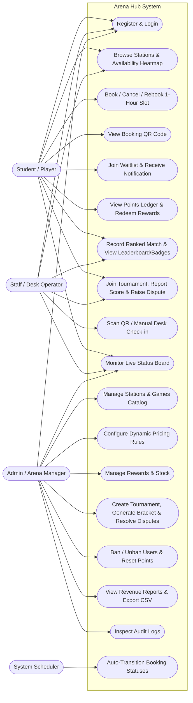
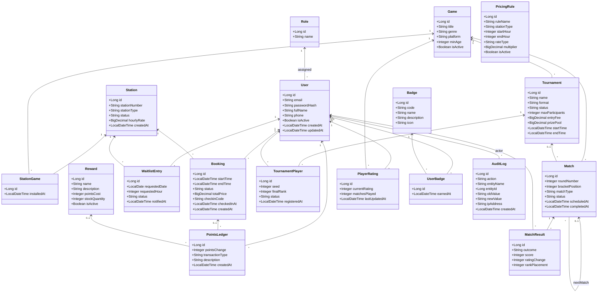
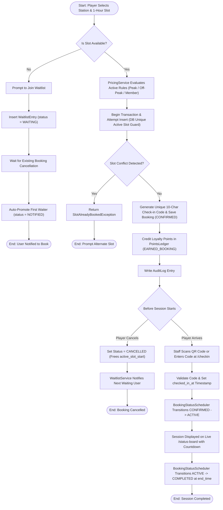
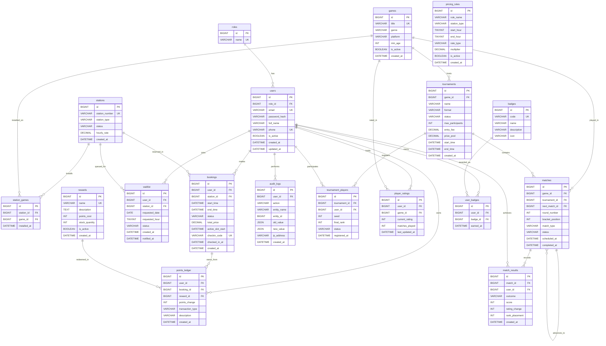

# Arena Hub - System Diagrams

This directory contains standalone Mermaid source files (`.mmd`) and rendered previews for the Arena Hub platform report.

## Table of Contents
1. [System Architecture](#1-system-architecture) (`system-architecture.mmd`)
2. [Use Case Diagram](#2-use-case-diagram) (`use-case-diagram.mmd`)
3. [Class Diagram](#3-class-diagram) (`class-diagram.mmd`)
4. [Activity Diagram](#4-activity-diagram) (`activity-diagram.mmd`)
5. [Entity-Relationship Diagram](#5-entity-relationship-diagram) (`er-diagram.mmd`)

---

## 1. System Architecture

```mermaid
flowchart TD
    subgraph Client["Client Layer (Web Browser)"]
        UI["Thymeleaf SSR Views + Bootstrap 5"]
        JS["Client Scripts (Chart.js, QRCode.js, html5-qrcode)"]
        POLL["Status Board Polling (/status-board/data)"]
    end

    subgraph Security["Security & Web Layer (Spring Security + Spring MVC)"]
        SEC["SecurityConfig (RBAC: STUDENT / STAFF / ADMIN, BCrypt, CSRF)"]
        CTRL["Feature Controllers (auth, catalog, booking, loyalty, elo, tournament, admin, audit)"]
        API["JSON & Export Endpoints (/status-board/data, /admin/reports/export.csv)"]
    end

    subgraph Service["Business Logic & Background Processing Layer"]
        SVC["Domain Services (Transactional + Pessimistic Locking)"]
        PRICE["PricingService (Peak / Off-Peak / Member Rules)"]
        ELO["EloService (Dynamic K=32/16 & Badge Evaluation)"]
        SCHED["BookingStatusScheduler (Auto CONFIRMED -> ACTIVE -> COMPLETED)"]
        AUD["AuditService (JSON Old/New State Trail)"]
    end

    subgraph Data["Persistence & Database Layer"]
        JPA["Spring Data JPA / Hibernate (ddl-auto=validate)"]
        JDBC["JdbcTemplate (SQL Reporting Views)"]
        FLY["Flyway Schema Migrations (V001 to V016)"]
        DB[("MySQL 8.0 Database (18 Tables + 3 Views + CHECK/UNIQUE Constraints)")]
    end

    UI --> SEC
    JS --> SEC
    POLL --> SEC
    SEC --> CTRL
    SEC --> API

    CTRL --> SVC
    API --> SVC
    SVC --> PRICE
    SVC --> ELO
    SVC --> AUD
    SCHED --> JPA

    SVC --> JPA
    SVC --> JDBC
    AUD --> JPA
    FLY --> DB
    JPA --> DB
    JDBC --> DB
```

---

## 2. Use Case Diagram

---

## 3. Class Diagram

---

## 4. Activity Diagram

---

## 5. Entity-Relationship Diagram

